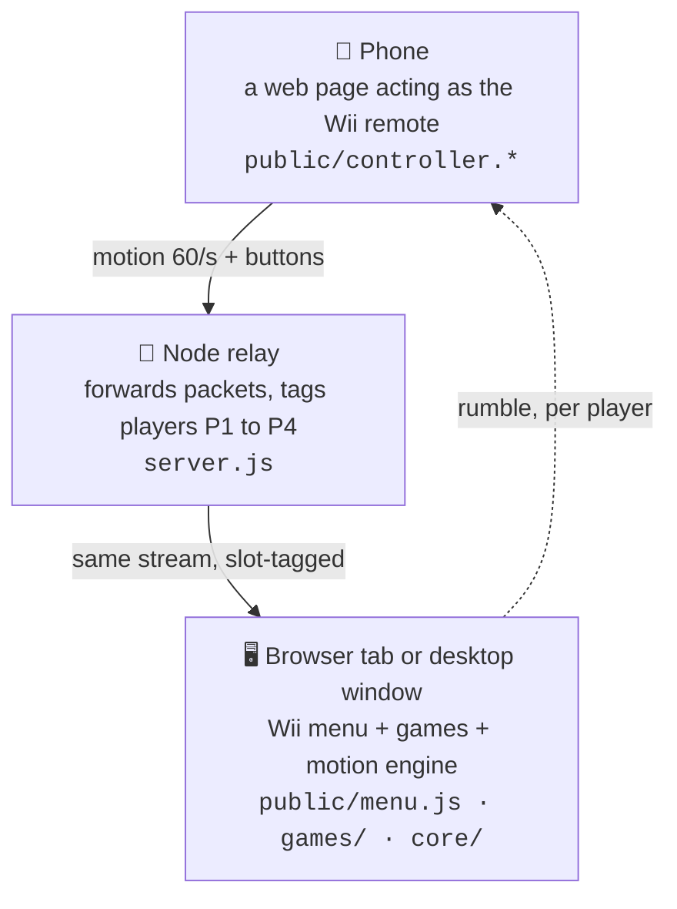

# 🕹 FreeWii

Your phone is the controller. Your computer runs the games.

Scan a QR code to turn your phone into a motion controller—no app or extra
hardware required. Up to four phones can join the same computer; player counts
vary by game.

## Desktop app

**[Download FreeWii for macOS, Windows, or Linux](https://binemugha.github.io/freewii/).**
The desktop app includes the games and local relay, so it does not require
Node.js, OpenSSL, or Chrome. Open it, scan the on-screen QR code with your phone,
and enable motion sensors on the phone's browser. Both devices must be on the
same Wi-Fi.

The macOS builds are signed with a Developer ID certificate and notarized by
Apple. Copy FreeWii into Applications and open it normally.

To run and package the desktop app from source:

```bash
npm ci
npm run desktop       # Development window
npm run desktop:dist  # Installers for the current OS in dist/
```

Pushing a tag named `v*` runs the desktop release workflow, builds macOS,
Windows, and Linux installers, and publishes them to the matching GitHub
release. The download website links to the latest release. The website deploys
to GitHub Pages when `website/` changes on `main`.

### Apple signing and notarization

The macOS release job requires a **Developer ID Application** certificate and
an **App Store Connect API key**. It requires Developer ID signing and verifies
both app architectures with `codesign`, `stapler`, and Gatekeeper before the
job can succeed.

1. In the [Apple Developer certificates page](https://developer.apple.com/account/resources/certificates/list),
   create a **Developer ID Application** certificate, then download and open it
   in Keychain Access. This certificate type is for distribution outside the
   Mac App Store; an Apple Development or Apple Distribution certificate will
   not work.
2. In Keychain Access, select **login → My Certificates**, expand the Developer
   ID certificate, select both the certificate and its private key, and export
   them as a password-protected `.p12` file.
3. Copy the certificate as base64 for GitHub:

   ```bash
   base64 -i freewii-developer-id.p12 | pbcopy
   ```

4. In App Store Connect, open **Users and Access → Keys**, create a key with
   the **Developer** role, download its `.p8` file, and note its Key ID and
   Issuer ID. Copy the key as one-line base64:

   ```bash
   base64 -i AuthKey_KEYID.p8 | tr -d '\n' | pbcopy
   ```

5. Add these [encrypted GitHub Actions secrets](https://github.com/binemugha/freewii/settings/secrets/actions):

   | Secret | Value |
   | --- | --- |
   | `MAC_CSC_LINK` | Base64 contents of the exported `.p12` certificate |
   | `MAC_CSC_KEY_PASSWORD` | Password chosen when exporting the `.p12` |
   | `APPLE_API_KEY` | One-line base64 contents of the `.p8` API key |
   | `APPLE_API_KEY_ID` | App Store Connect API Key ID |
   | `APPLE_API_ISSUER` | App Store Connect API Issuer ID |

Keep the `.p12`, `.p8`, passwords, and private keys out of git and chat. The
repository already ignores these certificate and key file types. The next `v*`
tag will create a signed, notarized, and stapled macOS release.

## Quick start from source

Requires **Node.js 22+**, a computer browser with WebGL 2, and a
motion-capable phone browser on the **same Wi-Fi**. OpenSSL is optional; the
server falls back to its bundled JavaScript certificate generator.

```bash
git clone https://github.com/binemugha/freewii.git
cd freewii
npm ci
npm start
```

1. Open **https://localhost:8443/** on your computer. On macOS, Chrome opens
   automatically.
2. Scan the launcher's QR code with your phone. Accept the local self-signed
   certificate, tap **Enable motion sensors**, and allow access.
3. Choose a game and follow its controls. Stop the server with **Ctrl+C**.

**Phone motion requires HTTPS.** Use the QR code or the terminal's **Phone remote**
address, not `localhost` on your phone. FreeWii is designed for shared local-network
play.

## Games

| Game | How to play | Players |
| --- | --- | --- |
| 🏎️ **[Mario Kart](games/mario-kart/README.md)** | Hold your phone sideways to steer, drift, boost and use items. The linked guide covers controls and included assets. | 1 human + 7 CPU racers |
| 🍉 **[Fruit Ninja](games/fruit-ninja/)** | Swing to slice fruit, dodge bombs and build combos. | Up to 4 |
| 🎳 **[Bowling](games/bowling/)** | Point to aim and swing to bowl through a full ten-frame game. | 1 |
| 👾 **[Alien Attack](games/alien-attack/)** | Tilt to fly and press A to fire. | 1 |
| 🎯 **[Shooting Range](games/shooting-range/)** | Point to aim and swing to bowl through a full ten-frame game. | 1 |
| 🎨 **[Sketch](games/drawing/)** | Point to aim and swing to bowl through a full ten-frame game. | 1 |

## How it works



A real Wii needs an IR sensor bar to know where the remote points; FreeWii replaces it with pure software. The
engine learns each phone's gyro axis conventions from its own data at runtime
(they genuinely differ between devices), heals drift back toward the true pose
between swings, and dead-reckons the cursor slightly ahead of the packet
stream so it never feels laggy.

## Troubleshooting

- **Cannot connect:** check both devices are on the same Wi-Fi, allow Node.js
  through the firewall, and avoid guest networks that isolate devices.
- **Buttons work but motion does not:** check HTTPS and motion permissions. If
  the terminal reports an HTTP fallback, check that the certificate directory
  is writable, then restart.
- **Black screen:** enable WebGL 2 / hardware acceleration in the computer browser.
- **No sound:** click the game to unlock audio and check its mute control.

Set `PORT` to use another port, or `NO_OPEN=1` to skip auto-opening Chrome.

## License

[MIT](LICENSE) for the software. This independent fan project is not
affiliated with or endorsed by Nintendo.
